TEAM: 15

MEMBERS: 1221063 & 1250400

This project was developed in a Linux environment.

---

**Q1**:
> The main problem with Scott's Dockerfile is the "COPY" instruction. This command follows the following format: ```COPY [source] [destination]```. It copies local files in ``source`` to the container image's in the ``destination`` path. By executing ```COPY . .``` Scott is copying every file present in his local filesystem into the container image, **including the .env file itself with its secrets**, allowing for anyone who replicates the image in their machine to access these secrets.

---

**Q2**:
> In order to retrieve the ``.env`` secrets we first explored the docker CLI tool. The `docker run` instruction allows us to run a command in a new container. First, we executed the `ls -la` command to list the directory including its hidden files (names starting with ".", such as .env).

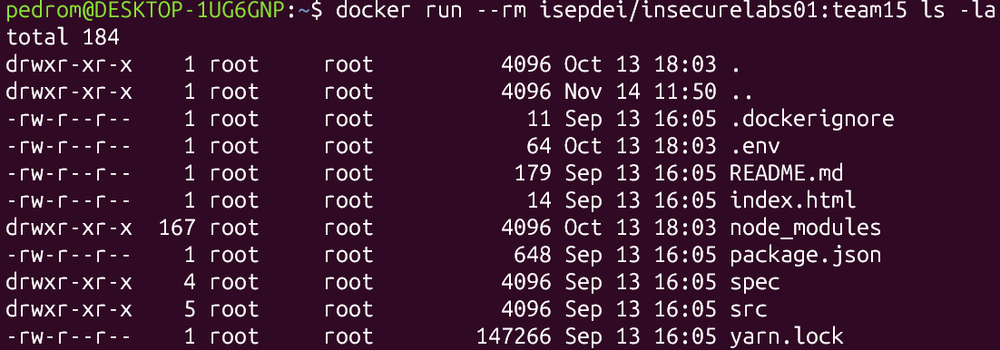

>After discovering the path to the ``.env`` file, we simply printed its contents to the standard output by using the `cat` command. 

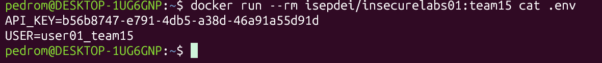

> **API_KEY**=b56b8747-e791-4db5-a38d-46a91a55d91d
> 
> **USER**=user01_team15
> 
> OBS.: we use the `--rm` flag to stop the container when it exits

---

**Q3**:
> To evaluate Tom's fix it's important to first understand the concept of Docker layers. Docker images are made of blocks, called **layers**. Layers are created when the container image is created from the Dockerfile, a *recipe* which defines the final image's file system structure. This file is composed of various commands that may or not change that file system. One core aspect of layers is that once created they remain in the final image **forever**. Tom's idea was to use the `RUN` docker command to run a command that deletes the `.env` file from the final image. However, since ```COPY . .``` was executed, there is a layer which will still be holding the new secrets present in the `.env`. This means that, although not present in the final's image file system, it is still possible to retrieve the secrets by analysing the corresponding layer. Concluding, Tom's solution is not very efficient.

---

**Q4**:
> To support the previous question's statements, we can use the **dive** CLI tool to analyse the docker image layer by layer:

```dive isepdei/insecurelabs02:team15``` 
>  When iterating over each layer it shows a snapshot of the filesystem of the image on that build phase.

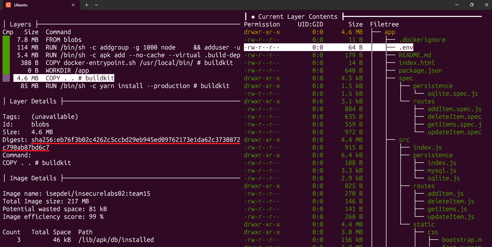

> The image above confirms the expected behaviour and when selecting the `COPY . .` layer we can see that the `.env` file is present in the filesystem.
> 
> The next step is to extract the contents of that file and retrieve the new secrets. By diving into the image we can see `.env` is inside the `app` directory which serves as a starting point for our search. We followed the procedure below:
> - We exported all layers into a single tarball using `docker save isepdei/insecurelabs02:team15 -o img.tar`. For each layer within the image, `img.tar` includes a tarball inside the `blobs/sha256` **containing their corresponding file system**.
> - Find out which tarball corresponds to the layer we want. Given our dive into the image, we know we are looking for the one containing the `app/.env` path.
> - Extract the contents of the `.env` file.
>
> To faciliate the 2nd and 3rd steps, we used the [**find-env.sh**](./TARGETS/target-4/find-env.sh) bash script to both **find** the `.env` file and **print** its secret contents to the standard output:

```bash
#!/bin/bash

# We prepare the directory to extract tarball contents
mkdir img && tar -xf img.tar -C img

ENV_PATH="none"

# We iterate over each tarball in blobs/sha256 looking for
# the one containing the app/.env path.

for f in img/blobs/sha256/*; do
        tar -tf "$f" 2>/dev/null | grep -q '^app/\.env' && ENV_PATH="$f" && break
done

# If there is no path, we report the "error" and exit
if [ "$ENV_PATH" = "none" ]; then
    echo ".env doesn't exist"
    exit 1
fi

echo "Found .env: $ENV_PATH"

echo "Secret:"

# We extract and print the .env file to the standard output
echo "$(tar -xf "$ENV_PATH" app/.env -O)"


exit
```

> **API_KEY**=a0115421-e198-4373-abe6-29ce9c6c1847
>
> **USER**=user02_team15

---

**Q5:**
> Firstly, we would use a **.dockerignore** file, which prevents all files that it lists to be integrated in the container image. By adding the `.env` entry to that file, when the `COPY . .` command executes it will ignore the `.env` file and copy everything else. It is important to ensure no other secrets are passed by explicitly including them in the `.dockerignore`. This partly solves the problem since although the secrets are no longer included in the final image or its layers, **``yarn install`` still requires the secrets**. To fix this, we also need to use **BuildKit** which will temporarly deliver the local `.env` file to `yarn install` without persisiting it in the image itself. For that, we need to change the Dockerfile as follows:

```Dockerfile
FROM node:18-alpine
WORKDIR /app
COPY . .
RUN --mount=type=secret,id=dotenv,target=/app/.env \
    yarn install --production

# By parts:
# --mount: BuildKit option that allows to temporarly mount something during this command.
# type=secret: It mounts a secret.
# id=dotenv: The name of the secret needed for this command (important during build)
# target=/app/.env: The path to the secret during the yarn install instruction

CMD ["node", "src/index.js"] EXPOSE 3000

```  

> This allows to **1) never include the secrets in the final image or any of its layers, and 2) provide the ``yarn install`` its needed secrets safely**.

---
---

**Q6:**

> According to the Linux documentation, it is possible to change the capabilites of an executable file by using the `setcap` command. Additionaly, the `-r` flag removes **all** of the capabilities associated to a program. Therefore, we can remove the `cap_net_raw` capability from the `ping` command by running:

`sudo setcap -r /usr/bin/ping`

> We can check it worked by performing the inverse operation `getcap` for the same executable:

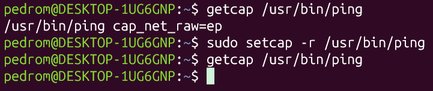

> To check if it worked, we created a new user **without `root` privileges** called `toor`. In theory, it shouldn't be able to user `ping`, **however** it was ([click here to see video](./videos/toor-mistery.mp4)):

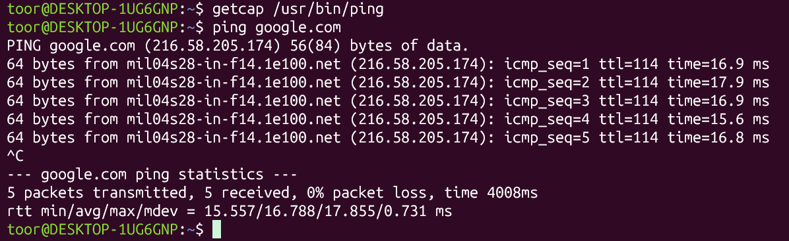

> (OBS.: If uid = 0, then the user has root privileges, otherwise it's unprivileged)
>
> After researching we found out about a Linux kernel parameter called **net.ipv4.ping_group_range**, which defines a range of group IDs that are allowed to open restricted sockets, opposed to the CAP_NET_RAW general-purpose socket. This range was was to a value that included **all** group IDs in the system, making it so any user can execute `ping`, even without the ``cap_net_raw`` capability. We decided to "break" this, so we can fix it as it is asked in **Question 7**, by running the following command:

`sudo sysctl -w net.ipv4.ping_group_range="1 0"`

> This defines an invalid range for the parameter and now `ping` describes the expected behaviour.

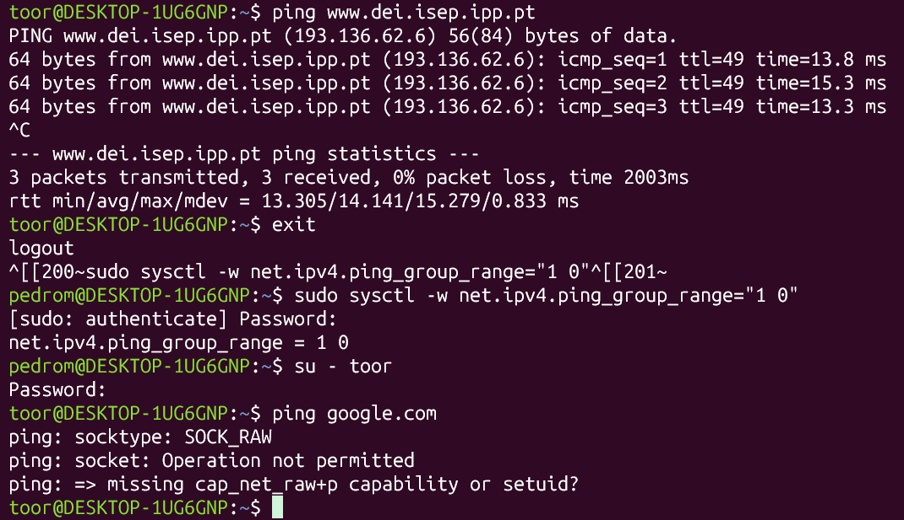

**Q7**

> As it is, no unpriviledged user can run `ping` now since we removed the needed capabilities. But that isn't sufficient: we also had to change the **net.ipv4.ping_group_range** parameter. This basically means we could have any user executing ``ping`` even without its capabilities, **as long as said parameter included all users**. However, to answer this question we also restricted ourselves from reverting the parameter change in **Question 6**: we can simply make ``ping`` **Set UID** ([click here for video](./videos/suid-ping.mp4)). We do this by running the following command:

`sudo chmod u+s /usr/bin/ping`

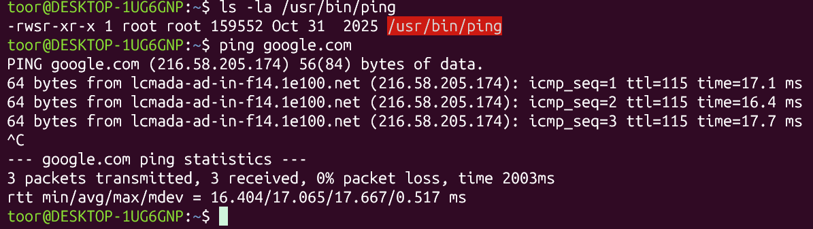

**Q8:**

> To answer this question, we follow the same procedure as in **Question 7** but **in reverse**. First, we must ensure that `passwd` loses its **Set UID** property by executing the following command:

`sudo chmod u-s /usr/bin/passwd`

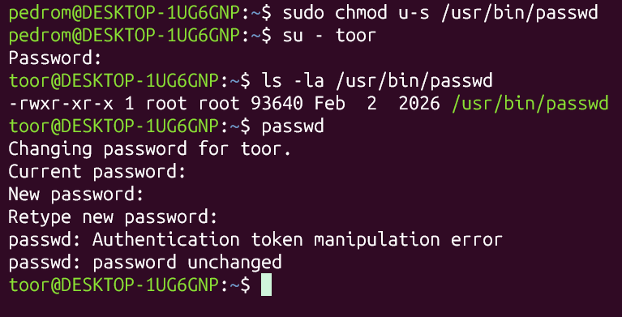
> (OBS.: ``passwd`` only requires priviledged status after all user inputs, therefore it only fails after typing the asked values. Also, it doesn't state any specific missing capabilities.)

> Contrary to what we saw in **Question 6**, the error message isn't very specific on what capabilities we need to add to make `passwd` usable again. This leaves two options: **trial and error**, we check each capability until cracking which are needed, or we **add every capability** to ``passwd``, rendering it identical as if it had **Set UID** properties. We opted for the second, because the `passwd` command requires many functionalities regarding authentication within the Linux system (more on that later). For this, we executed the following command:

`sudo setcap all+ep /usr/bin/passwd`

> Now, ``passwd`` is usable by any user, even when not marked with **Set UID** ([click here to watch the video](./videos/dirty-passwd.mp4))

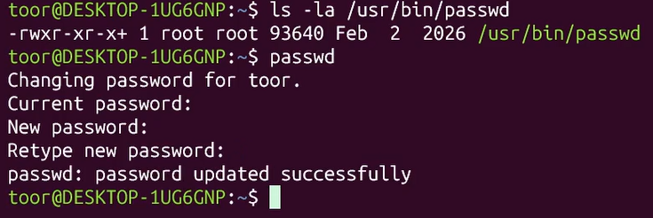

**Q9:**

> As we have seen, `ping` requires one well-defined capability: `cap_net_raw`. If we follow **The Principle of Least Privilege** it doesn't make sense to give `ping` any more permissions than those it **necessarily needs to fulfil its purpose**. On the other hand, `passwd` doesn't explicitly say what capabilities it was missing when we removed the **Set UID** attribute. This means we don't know exactly which privileges it requires to execute, and this is further enforced by the introduction of **Pluggable Authentication Modules** (PAM). PAM is a layer that decouples the authentication logic from the applications that rely on it: instead of `passwd` (or `login`, `sudo`, `sshd`, and others) implementing its own code to verify credentials or write to `/etc/shadow`, it delegates this work to a stack of configurable modules (e.g. `pam_unix.so`), defined per-application in `/etc/pam.d/`. As a result, the generic `passwd: Authentication token manipulation error` we observed does not originate from `passwd` itself, but is raised by the underlying PAM module when one of its internal operations fails — without specifying which one. Because of this, PAM may require privileges that vary across different systems, depending on which modules are configured and what they do under the hood, making it impossible to pinpoint exactly which capabilities it needs from the error message alone.

**Q10:**

After reading the Linux manual pages on **capabilities**, we chose the following 10:

- **CAP_KILL**: Allows a process to send signals to other processes it does not own, bypassing the rule that a signal can only be sent between processes with matching UIDs (or by root). Without it, a normal user can only kill their own processes.

- **CAP_DAC_OVERRIDE**: Allows a process to bypass file read, write, and execute permission checks entirely, regardless of the file's owner, group, or mode bits.

- **CAP_CHOWN**: Allows a process to make arbitrary changes to a file's UID and GID.

- **CAP_SYS_TIME**: Allows a process to set the system clock and the hardware (RTC) clock.

- **CAP_SYS_BOOT**: Allows a process to reboot the system or load a new kernel for execution.

- **CAP_SYS_NICE**: Allows a process to raise its own process priority and change the scheduling policy/priority of other processes.

- **CAP_SYS_PTRACE**: Allows a process to trace and inspect other processes via `ptrace()`, including reading/writing their memory, registers, and syscalls. Granting this is very risky, since it can expose secrets held in another process's memory.

- **CAP_AUDIT_CONTROL**: Allows a process to enable/disable kernel auditing.

- **CAP_AUDIT_READ**: Allows a process to read the kernel's audit log.

- **CAP_AUDIT_WRITE**: Allows a process to write records into the kernel's audit log.

**Q11:**

> Assuming disabled means not **Effective** but currently **Permitted**:
> 
> Since the capability is still in the process’s Permitted set, albeit inactive, the attacker's code can simply call `capset` to make cap_dac_override **Effective** again. No new privilege is required since the process was always allowed to re-enable a capability it already holds in **Permitted**.
>
> Assuming removed means a capability is neither **Effective** nor **Permitted**:
> 
> Now the capability is completely gone. There is nothing the attacker can do from within the processto bring it back, because ``capset`` can **only change capabilities that are still present in Permitted**. The only way to get cap_dac_override back at this point would be through a different process that has those capabilities. This requires the attacker to locate, on that specific machine, such an executable and have permission to execute it, something that is **not** guaranteed to exist. This makes deletion a stronger safeguard.

**Q12:**

> The outputs are as follows:

```bash
$ docker exec captest sh -c 'capsh --print'
Current: cap_chown,cap_dac_override,cap_fowner,cap_fsetid,cap_kill,cap_setgid,cap_setuid,cap_setpcap,cap_net_bind_service,cap_net_raw,cap_sys_chroot,cap_mknod,cap_audit_write,cap_setfcap=ep
Bounding set =cap_chown,cap_dac_override,cap_fowner,cap_fsetid,cap_kill,cap_setgid,cap_setuid,cap_setpcap,cap_net_bind_service,cap_net_raw,cap_sys_chroot,cap_mknod,cap_audit_write,cap_setfcap
Ambient set =
Current IAB: !cap_dac_read_search,!cap_linux_immutable,!cap_net_broadcast,!cap_net_admin,!cap_ipc_lock,!cap_ipc_owner,!cap_sys_module,!cap_sys_rawio,!cap_sys_ptrace,!cap_sys_pacct,!cap_sys_admin,!cap_sys_boot,!cap_sys_nice,!cap_sys_resource,!cap_sys_time,!cap_sys_tty_config,!cap_lease,!cap_audit_control,!cap_mac_override,!cap_mac_admin,!cap_syslog,!cap_wake_alarm,!cap_block_suspend,!cap_audit_read,!cap_perfmon,!cap_bpf,!cap_checkpoint_restore
Securebits: 00/0x0/1b0 (no-new-privs=0)
 secure-noroot: no (unlocked)
 secure-no-suid-fixup: no (unlocked)
 secure-keep-caps: no (unlocked)
 secure-no-ambient-raise: no (unlocked)
uid=0(root) euid=0(root)
gid=0(root)
groups=0(root)
Guessed mode: HYBRID (4)

$ docker exec captest sh -c 'grep Cap /proc/1/status'

CapInh: 0000000000000000
CapPrm: 00000000a80425fb
CapEff: 00000000a80425fb
CapBnd: 00000000a80425fb
CapAmb: 0000000000000000
```

> The output provided by `print` shows the **current** state of the capabilities for each process inside the container. This is shown by the 'Current' list, and it says that there are **no Inherited** capabilities, while the following are marked as both **Permitted** and **Effective**:   

> - `CAP_CHOWN`
> - `CAP_DAC_OVERRIDE`
> - `CAP_FOWNER`
> - `CAP_FSETID`
> - `CAP_KILL`
> - `CAP_SETGID`
> - `CAP_SETUID`
> - `CAP_SETPCAP`
> - `CAP_NET_BIND_SERVICE`
> - `CAP_NET_RAW`
> - `CAP_SYS_CHROOT`
> - `CAP_MKNOD`
> - `CAP_AUDIT_WRITE`
> - `CAP_SETFCAP`

> By running the decoding command, we get the following output:

```bash
$ docker exec captest sh -c 'capsh --decode=00000000a80425fb'
0x00000000a80425fb=cap_chown,cap_dac_override,cap_fowner,cap_fsetid,cap_kill,cap_setgid,cap_setuid,cap_setpcap,cap_net_bind_service,cap_net_raw,cap_sys_chroot,cap_mknod,cap_audit_write,cap_setfcap
```
> By confronting this with the `grep` output, we conclude they are the same, proving to be both options to verify the capabilities inside a docker container.

**Q13:**

> After dropping all capabilities, it is no longer possible to run the `ping` command:

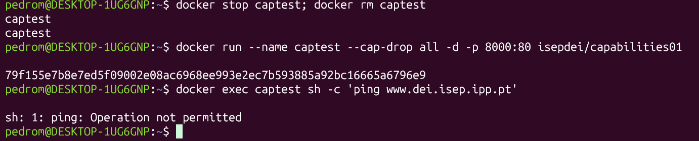

> As we have seen before, the `ping` command requires the **cap_net_raw** capability to execute. Our solution revolved around the `docker run` command itself. For `ping` specifically, we can drop all but the **cap_net_raw** capability, allowing us to use `ping` while keeping the `--cap-drop all`:

`docker run --name captest --cap-drop all --cap-add net_raw -d -p 8000:80 isepdei/capabilities01`

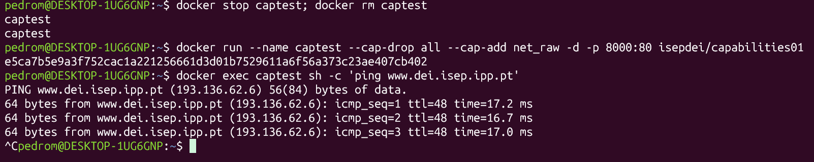

> And now, the ``print`` command shows that the only capability available for container processes is **cap_net_raw**.

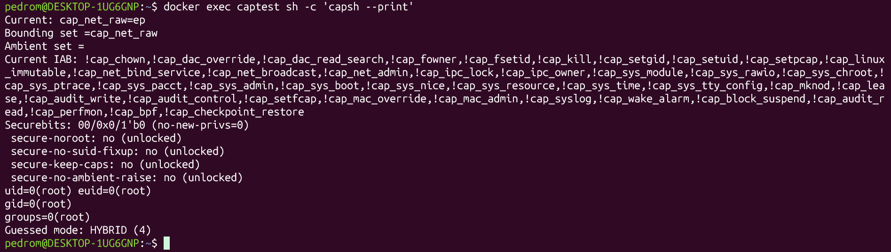

---

**Q14:**

> By running the docker with the `--priviledged` flag, Scott is giving all processes within the container **every single Linux capability**. By using the `print` command from before we can confirm this:

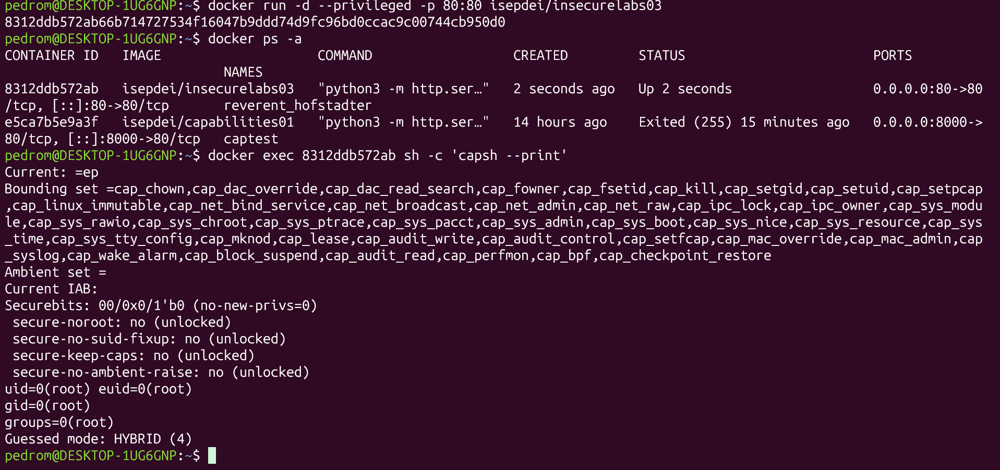

**Q15:**

> The use of the `--privileged` flag allows the container to have all capabilities, disregarding the Principle of Least Privilege and essentially giving every process in the container the power to do the same as the host's root user. Without these restrictions, bypassing isolation mechanisms is **facilitated**, and the host itself can be breached, exposing sensitive data or enabling further attacks/exploits.
>
> Moreover, since the `fdisk` tool is installed, an attacker will have access to the host machine's partitions, easing their creation, modification, and deletion.
>
> To demonstrate this, we used the `fdisk` tool from the container to: 1) view the host's partitions, 2) create a new one and confirm it exists on the host, and 3) delete that same partition (this deletion could target any other partition on the host). The `fdisk` commands used are as follows:
>
> - `fdisk -l /dev/sda` — Lists all available partitions.
> - `printf "n\n\n\n\n+100M\nw\n" | fdisk /dev/sda` — Creates a new 100 MB partition on the disk.
> - `printf "d\n3\nw\n" | fdisk /dev/sda` — Deletes the partition.
>

>
> ([Click here to watch the video of this attack](./videos/Q15.mp4))

**Q16:**

> After some research, we found out about escapes that exploit misconfigured mount points when running containers. When mounting a folder from the host into the container environment, it is important to do so carefully, only granting the container access to what it actually needs; otherwise, malicious files can be injected into the host system.
>
> Let's imagine the container needs access to a file at `/etc/important-file.csv`, and Scott runs the container on his machine with the following command:
>
> ```bash
> sudo docker run -d --name container --mount type=bind,source=/etc,target=/attack_etc isepdei/insecurelabs03
> ```
>
> The `--mount` option mounts the source folder (`/etc` on Scott's machine) to the target folder (`/attack_etc` in the container).
>
> This creates a serious problem: if the container is breached, the attacker can attack not just the one file that was needed, but the **entire** `/etc` directory. To demonstrate this, we created a container with the configuration above and modified files on Scott's machine.
>

>
> Note that we started the container **without any capabilities at all**, and it was still possible to change Scott's files ([click here to watch the video](./videos/Q16.mp4)).
>
> Concluding, this misconfiguration left Scott's `/etc` directory — which is owned by root — completely exposed to any attacker with a foothold in the container. This was possible despite the complete absence of capabilities, since by default the container's main process also runs as root (UID 0), and standard Unix file permission checks on the host are satisfied by that UID regardless of which capabilities are present. This proves that the mount functionality in containers deserves the utmost attention when used. Some ways to avoid this type of attack are:
>
> - Avoid mounting sensitive directories.
> - Use read-only mounts when write access is not needed.
> - Apply the Principle of Least Privilege: mount only what is strictly necessary, and nothing else.


**Q17:**

> The questions in this assignment helped us understand how container isolation is built from several independent mechanisms, which can be combined to ensure security. We worked through different scenarios, developing solutions that deepened our understanding of how to protect Docker containers from being exploited. Given what we learned, we suggest the following as Docker security measures:


> - **Secrets must never be embedded into any layer of a Docker image.** As shown in Part 1, even deleting a secret in a later layer (`RUN rm .env`) does not remove it from the layers that still contain it. The use of a `.dockerignore`, to keep secrets out of the build context, and BuildKit, to mount secrets when a build step genuinely needs them, ensures they never persist anywhere in the image.
>
> - **Containers should run with as few privileges as possible.** It's preferable to drop all capabilities (`--cap-drop all`) and add just the necessary ones with `--cap-add`, rather than relying on the default capability set.
>
> - **Avoid `--privileged` entirely, and limit access to the host filesystem.** As we saw with Scott's `insecurelabs03` container, `--privileged` grants every capability and disables seccomp/AppArmor simultaneously, effectively removing isolation from the host. Grant read-only access when possible, avoid bind-mounting sensitive host directories, and prefer Docker volumes for persistent data instead of direct host paths.
>
> - **Use minimal, trusted base images.** Avoid installing unnecessary utilities that expand the attack surface if the container is compromised, and pull images only from verified, trusted sources.
>
> - **Prefer container-to-container networking over the host network.** Avoid exposing ports that aren't strictly necessary.
>
> - **Monitor and log container activity.** Audit logging helps detect anomalous behavior, enabling faster response to a compromised container.
>
> - **Make full use of the isolation mechanisms Docker already provides.** Each addresses a different aspect of isolation:
>   - **Namespaces** — separate resources such as processes, networking, and filesystems, giving each container its own isolated view of the system.
>   - **Control groups (cgroups)** — limit and monitor resource usage (CPU, memory), preventing any one container from starving the others.
>   - **Seccomp** — restricts which system calls a container can make, reducing the attack surface even when a capability is present.
>   - **AppArmor / SELinux** — mandatory access control mechanisms that further restrict what specific resources a process can access, beyond standard Unix permissions.